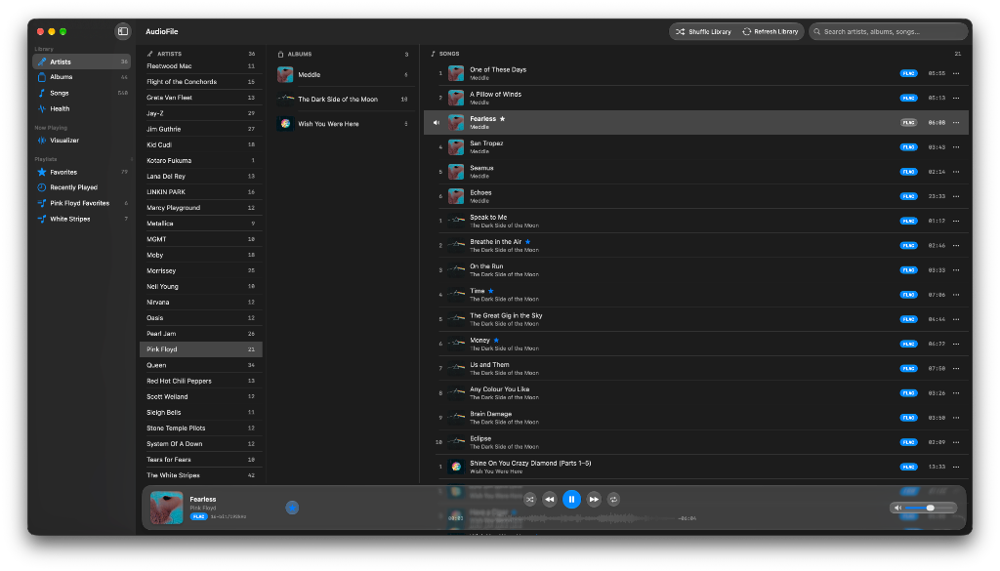
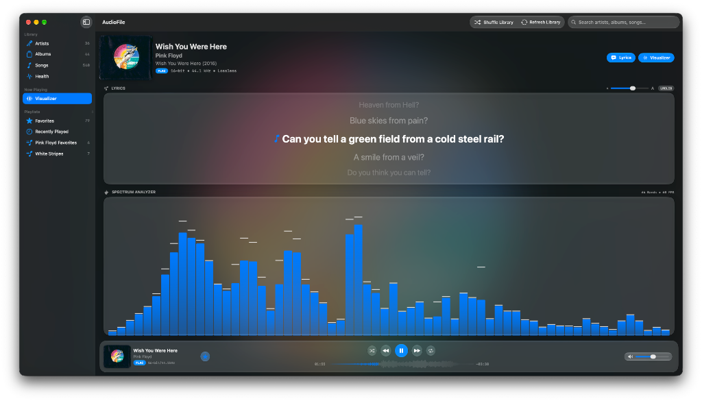
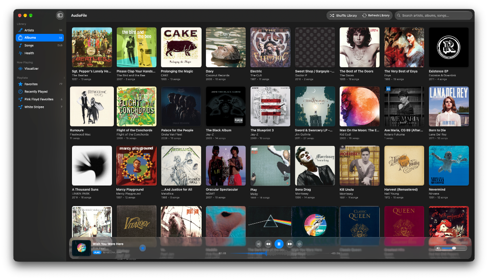

# ♬ AudioFile

> **High-Fidelity Native macOS Audiophile Music Player**  
> Built with Swift 6, SwiftUI **Liquid Glass** (macOS 26+), AVFoundation, CoreAudio, and Accelerate (`vDSP`).  
> Engineered to deliver complete audiophile parity with [**OmaFLAC**](https://github.com/jonecat/omaflac) in a native macOS Liquid Glass interface.

`AudioFile` is a native macOS audio player designed for audiophiles who demand bit-perfect lossless playback, high-resolution metadata, real-time 64-band FFT spectrum visualization, 5-line synchronized lyrics, and deep Apple ecosystem integration. Built with Apple's native **Liquid Glass** design system (`Glass`, `.glassEffect`, `GlassEffectContainer`, and `.glassEffectID`), every accented element dynamically adapts to your macOS **System Settings → Appearance** accent color.

<p align="center">
  
</p>

## ⬇️ Download & Install Pre-Built macOS App (No Compilation Required)

### Recommended: 1-Line Terminal Install (Bypasses macOS Gatekeeper Warning)
Run this in Terminal to download the latest pre-built `AudioFile.app` from GitHub Releases, install it into `/Applications`, and launch it immediately without any Gatekeeper prompt:

```bash
curl -fsSL https://raw.githubusercontent.com/jonecat/audiofile/main/scripts/install.sh | bash
```

### Direct Browser Downloads
- **[Download `AudioFile.dmg` (macOS Disk Image Installer)](https://github.com/jonecat/audiofile/releases/latest/download/AudioFile.dmg)**
- **[Download `AudioFile.app.zip` (Standalone App Bundle)](https://github.com/jonecat/audiofile/releases/latest/download/AudioFile.app.zip)**
- **[View All Releases on GitHub](https://github.com/jonecat/audiofile/releases/latest)**

*(If downloading via a web browser, run `xattr -cr /Applications/AudioFile.app` once after moving to `/Applications` to clear browser quarantine. All future updates installed via the built-in updater bypass Gatekeeper automatically.)*

---

## 📸 Screenshots

### 3-Column Library Browser (Artists → Albums → Songs)
Complete hierarchical navigation with live artist, album, and song counters, lossless quality pills, and favorite stars:
<p align="center">
  
</p>

### Now Playing: 5-Line Synced Lyrics & 64-Band FFT Spectrum Visualizer
Real-time 64-band hardware-accelerated spectrum analyzer alongside 5-line synchronized lyrics with live scaling slider:
<p align="center">
  
</p>

### Adaptive Albums Grid View
High-resolution album artwork covers with release year, track counts, and floating bottom player deck:
<p align="center">
  
</p>

---

## ✨ Features

- **Native macOS 26+ Liquid Glass Interface**:
  - Floating Liquid Glass bottom player deck (`PlayerBarView`) with circular interactive glass transport buttons, waveform seekbar, compact dynamic range badge, and capsule volume deck.
  - Morphing Liquid Glass pill tabs (`GlassEffectContainer` + `.glassEffectID`) in the **Settings (`⌘,`)** window.
  - High-contrast lossless format badges (`FLAC`, `ALAC`, `WAV`, `AIFF`, `DSD`, `APE`, etc.) with comprehensive format detail tooltips.
  - Full-row selection contrast that keeps active/playing tracks crisp when highlighted.
  - Dynamic system accent color integration: all active controls, spectrum analyzer bars, waveform progress, format badges, and lyric highlights follow the macOS Appearance accent color in real time.
  - Rock-solid hover tooltips (`.help`) across all buttons, badges, and controls, isolated from high-frequency playback position updates so tooltips never flicker or dismiss during playback.
- **On-Demand Dynamic Range (DR) Meter Engine (PMF / TT Standard)**:
  - Official Pleasurize Music Foundation (TT Dynamic Range Meter / [dr.loudness-war.info](https://dr.loudness-war.info)) algorithm.
  - Analyzes audio in 3-second blocks with AES-17 RMS scaling (+3.01 dB sine wave reference), calculating dynamic range between the second-highest peak block and the top 20% loudest RMS blocks.
  - Color-coded Liquid Glass badge in both the Now Playing header and floating bottom player bar:
    - **Audiophile Dynamic Range (`DR 14+`)**: Accent green / emerald.
    - **Transition / Standard Dynamic (`DR 8–13`)**: Accent amber / yellow.
    - **Compressed / Loudness War (`DR 1–7`)**: Coral / red.
  - Miniature animated loading spinner while analyzing streams on-demand.
  - Permanent persistent database (`~/Library/Application Support/AudioFile/dynamic_range_db.json`) for instant 0ms recall across app restarts without re-analyzing.
  - Rich hover tooltips detailing official DR score, peak energy, and RMS loudness.
- **Audiophile Lossless Playback & CoreAudio + Open-Source Decoder Engine**:
  - Native hardware-accelerated decoding for **FLAC**, **ALAC** (Apple Lossless), **WAV**, **AIFF**, **M4A/AAC**, and **MP3** via Apple `AVFoundation` and `CoreAudio`.
  - Built-in studio-grade decoding for **DSD** (`.dsf`, `.dff` 1-bit 2.82 MHz / 5.64 MHz SACD streams) prioritizing FFmpeg multi-stage decimation with a 40 kHz lowpass filter to 24-bit 88.2 kHz PCM WAV, eliminating high-frequency quantization hiss (>20 kHz) down to -88 dB SNR, with native pure-Swift FIR decimation fallback.
  - Thread-serialized decoder locking (`decodeLock`) preventing race conditions across concurrent player, waveform, and dynamic range analyzer routines.
  - Native Monkey's Audio (**APE**) support via APEv2/MAC header parsing and lossless PCM caching.
  - Full support for **1-bit DSD**, **16-bit**, **24-bit**, and **32-bit Float** lossless audio with exact sample rates (`44.1 kHz` – `192 kHz` PCM and `2.82 MHz` / `5.64 MHz` DSD64/DSD128).
  - True **gapless transitions** with double-buffered boundary sample alignment.
  - **Continuous Library Shuffle (`⇧⌘S`)**: Top-toolbar **Shuffle Library** button shuffles your entire collection and automatically queues freshly shuffled passes as the queue nears completion so playback never stops until you stop it.
  - Software volume boost up to 150% and instant mute/unmute.
- **Synchronized 5-Line Lyrics Engine**:
  - **Multi-Stage LRCLIB Integration**: Fetches time-synchronized `.lrc` lyrics on-demand via [LRCLIB](https://lrclib.net) using exact `/api/get` matching, remaster/edition suffix stripping, and multi-stage `/api/search` fallback scored by artist, title, album, and track duration, with automatic retry/backoff on transient `503`/`429` responses.
  - **Local Sidecar `.lrc` Priority**: Automatically detects and loads `<track>.lrc` files located alongside audio tracks in your library.
  - **Offline Disk Caching**: Saves fetched `.lrc` files locally (`~/Library/Caches/AudioFile/lyrics/`) for instant 0ms offline access without poisoning cache on transient network errors.
  - **5-Line Synchronized Window & Adjustable Text Size Slider**: Displays 2 previous lines, the active lyric line, and 2 upcoming lines, with a live **Text & Card Size Slider** (`0.85x–2.8x`) that dynamically expands the Lyrics card and scales the Spectrum Analyzer to fit.
  - **Smooth Instrumental Break Scrolling**: Normalizes instrumental intros, breaks, and outros (`♪ Instrumental Break ♪`) into timeline entries so instrumental sections scroll smoothly through all 5 rows (`next2 → next1 → curr → prev1 → prev2`).
- **Multi-Mode Real-Time Hardware-Accelerated Visualizer**:
  - Live audio tap feeding a 2048-point Fast Fourier Transform via the **Accelerate framework (`vDSP`)**.
  - **3 Distinct Visualization Modes**:
    - **Spectrum Bars**: 64 logarithmically spaced frequency bands (`20 Hz – 20,000 Hz`) with equal-loudness treble compensation, logarithmic dB scaling, and dynamic attack/decay envelope ballistics with peak-hold caps.
    - **Dual Analog VU Meter (`DualVUMeterView`)**: Real-time left/right channel VU needles with analog needle ballistics, dB graduations, and redline peak indicators.
    - **Circular Spectrum (`CircularSpectrumView`)**: 360-degree radial spectrum analyzer with concentric accent glow.
  - Seamless mode cycling by tapping directly on the visualizer canvas or via the mode picker menu.
  - User-configurable refresh rates: **30 FPS (Energy Saver)**, **60 FPS (Default Smooth)**, and **120 FPS (ProMotion Ultra)**.
  - Dedicated **Lyrics** and **Visualizer** pill toggles directly inside the Now Playing / Visualizer header.
- **High-Resolution Track Dynamics Waveform Scrubber**:
  - Pre-calculates 512 amplitude dynamics bins in background worker tasks and caches waveforms on disk (`~/Library/Caches/AudioFile/waveforms/`).
  - Interactive seekbar in the floating bottom player deck with played vs. unplayed accent contrast and click/drag scrubbing.
- **Library Health Inspector & Batch Tag Fixer (`HealthView`)**:
  - Built-in audit dashboard analyzing your entire music collection for metadata hygiene.
  - Detects and categorizes issues across 5 core categories:
    - **Missing Info**: Unclean titles, missing artist, album, or track numbers.
    - **Missing Artwork**: Albums or songs lacking cover art.
    - **Split Albums**: Inconsistent album titles or artist tags fragmenting single albums.
    - **Missing Lyrics**: Songs missing synced `.lrc` lyrics.
    - **Duplicates**: Multiple copies of the same song across files or directories.
  - **Automated Fix Finder**: Searches online music metadata databases to suggest clean tags, release years, and track numbers.
  - **Configurable Tag Saving**: Choose between saving metadata updates to the internal database only, or writing ID3/MP4/Vorbis tags directly to audio files on disk with optional automatic file renaming.
  - **Batch Approval**: One-click "Approve All" to apply fixes across entire issue categories simultaneously.
  - Ignored issues persistence (`~/Library/Application Support/AudioFile/ignored_health_issues.json`).
- **Track Metadata Inspector & Editor**:
  - Native Liquid Glass modal sheet (`TrackMetadataSheetView`) to view and edit track metadata tags (Title, Artist, Album, Album Artist, Track #, Total Tracks, Disc #, Year).
  - Available from any track's context menu or kebab (`⋯`) button.
- **Hierarchical Library, Multi-Selection & Playlists**:
  - **Artists (`⌘1`)**: 3-column macOS browser (**Artists → Albums → Songs**) with draggable horizontal column dividers, track and disc counts, favorite stars, and binary MP4/M4A, ID3, and filename-prefix sorting.
  - **Albums (`⌘2`)**: Adaptive album artwork grid with release year, track count, and Liquid Glass modal tracklist sheet.
  - **Songs (`⌘3`)**: Native macOS sortable `Table` with single and multi-selection, double-click playback, format pills, quality readout, favorite stars (`★`), and per-row kebab (`⋯`) menus.
  - **Multi-Selection & Batch Operations**: Select multiple tracks across Artists, Songs, Albums, or Playlists using **⌘-click**, **⇧-click**, or **⌘A**. Press **`F`** to batch-favorite all selected tracks, or use the context menu / `⋯` button to batch add to playlists, queue next, or reveal in Finder.
  - **Visualizer / Now Playing (`⌘4`)**: Hero view with album artwork, format badge, dynamic range badge, adjustable 5-line synchronized lyrics, and live multi-mode spectrum analyzer. Click the album art to open a full-resolution artwork modal with embedded pixel dimensions (`px`).
  - **Library Health (`⌘5`)**: Dedicated health inspection and metadata repair center.
  - **Playlists (`⌘5` / `⌘6`)**: Built-in **★ Favorites**, **🕒 Recently Played**, and custom user playlists with tactile drag handles for animated drag-and-drop reordering.
  - **Interactive Toast Notifications**: Floating Liquid Glass capsule pills provide instant feedback when favoriting or adding single/multiple songs to playlists.
  - **Unified Context & Kebab (`⋯`) Menus**: Right-click any track or click its `⋯` button to **Play**, **Play Next**, **Favorite**, **Edit Metadata**, **Add to Playlist**, **Remove from Playlist**, or **Show in Finder**.
  - **Settings (`⌘,`)**: Native macOS application menu integration (**AudioFile → Settings…**) with 5 Liquid Glass tabs (**Library**, **Audio**, **Visualizer**, **Lyrics**, and **About** specification table).
- **Incremental Background Library Sync (NAS & Remote Friendly)**:
  - Instant startup loading from cached `~/Library/Application Support/AudioFile/library.json` with automatic metadata backfill for track/disc numbers.
  - Non-destructive incremental background scanner using file size and modification timestamp (`stat`) caching.
  - Unmounted network drive protection: prevents wiping cached tracks if a remote NAS or external drive is offline.
- **Full macOS System Integration & Automatic GitHub Self-Updater**:
  - **Automatic Point-Release Self-Updater (`AppUpdater`)**: Checks GitHub Releases (`jonecat/audiofile`) on launch and via **AudioFile → Check for Updates…**, prompts when a newer point release (`1.0.1`, `1.0.2`, etc.) is available, downloads `AudioFile.app.zip`, replaces the installed app bundle in-place, and automatically reboots `AudioFile`.
  - **Menu Bar**: Native **AudioFile**, **Controls**, and **View** menus with standard keyboard shortcuts.
  - **Media Keys & Control Center**: Full integration with `MPNowPlayingInfoCenter` and `MPRemoteCommandCenter` (track title, artist, album, artwork, and playback progress appear in macOS Control Center and Lock Screen).
  - **Drag and Drop**: Drag audio files or folders directly into the window to play immediately or add to your library.

---

## ⌨️ Controls & Shortcuts

| Action | Shortcut / Mouse |
| :--- | :--- |
| **Play / Pause** | `Space` or media key |
| **Play Selected Track** | Double-click track row (single-click selects row) |
| **Next Track** | `⌘→` / `⌘]` or click `▷\|` |
| **Previous Track** | `⌘←` / `⌘[` or click `\|◁` |
| **Shuffle Entire Library (Continuous)** | `⇧⌘S` or click **Shuffle Library** in top toolbar |
| **Seek Backward / Forward 5s** | `Shift + ←` / `Shift + →` or click waveform scrubber |
| **Seek Backward / Forward 30s** | `⌥⌘←` / `⌥⌘→` |
| **Volume Up / Down** | `+` / `-` or volume slider |
| **Mute / Unmute** | `M` or click speaker icon |
| **Cycle Repeat Mode (Off / All / 1)** | `R` or click repeat button |
| **Toggle Queue Shuffle** | `Z` or click shuffle button |
| **Toggle Lyrics Card** | `L` or click **Lyrics** pill on Visualizer screen |
| **Favorite Track(s)** | `F` or click `★` (favorites selected track(s) or currently playing track) |
| **Multi-Select Tracks** | `⌘-Click` individual tracks or `⇧-Click` track ranges |
| **Select All Tracks** | `⌘A` in any track list or table |
| **Global Search** | `⌘F` or click toolbar search field |
| **Switch to Artists View** | `⌘1` |
| **Switch to Albums View** | `⌘2` |
| **Switch to Songs View** | `⌘3` |
| **Switch to Visualizer / Now Playing** | `⌘4` |
| **Switch to Library Health** | `⌘5` |
| **Switch to Recently Played** | `⌘6` |
| **Cycle Visualizer Mode (Bars / VU / Circle)** | Click visualizer canvas or select mode in menu |
| **Calculate Dynamic Range (DR)** | Click `DR` badge in Now Playing or Player Bar |
| **View / Edit Track Metadata** | Right-click track → **View / Edit Metadata…** |
| **Open Settings** | `⌘,` (**AudioFile → Settings…**) |

---

## 🛠️ Building & Running

### Requirements
- **macOS 26.0+** (Liquid Glass SDK)
- **Xcode / Command Line Tools** with Swift 6.2+

### Build & Run from Command Line
```bash
# Clone the repository
git clone https://github.com/jonecat/audiofile.git
cd audiofile

# Run directly in debug mode
swift run AudioFile
```

### Build the Standalone Application Bundle (`AudioFile.app`)
```bash
# Compile optimized release build and package into ad-hoc signed AudioFile.app
./scripts/build_app.sh

# Launch the built macOS application
open AudioFile.app
```

You can drag `AudioFile.app` directly into your `/Applications` folder.

### Publish a New Point Release to GitHub (`1.0.0` → `1.0.1` → `1.0.2`)
```bash
# Automatically increments the patch version in VERSION & Info.plist,
# builds AudioFile.app & AudioFile.app.zip, commits, tags (v1.0.x), pushes to main,
# and publishes the GitHub Release with the compiled AudioFile.app.zip binary attached:
./scripts/release.sh
```

---

## 🏗️ Architecture

```text
audiofile/
├── VERSION                                 # Current semantic version (auto-incremented on release)
├── Package.swift                           # Swift Package Manager configuration (.macOS(.v26), Swift 6)
├── Resources/
│   ├── Info.plist                          # macOS bundle configuration & audio file associations
│   ├── AppIcon.icns                        # High-resolution Retina application icon (16x16 to 1024x1024)
│   └── AppIcon_1024.png
├── scripts/
│   ├── build_app.sh                        # Release compilation, bundle packager & AudioFile.app.zip creator
│   └── release.sh                          # Automatic point-release bumper, tagger & GitHub Release publisher
└── Sources/
    └── AudioFile/
        ├── AudioFile.swift                 # @main SwiftUI App entry point, Check for Updates, Settings (⌘,) & menus
        ├── Updater/
        │   └── AppUpdater.swift            # GitHub Releases version checker, self-updater & auto-relauncher
        ├── Models/
        │   ├── Track.swift                 # Audio track metadata model, format descriptors & quality info
        │   ├── Playlist.swift              # Playlist and PlaylistsData models
        │   ├── AppConfig.swift             # Persistent app configuration (folders, volume, repeat, FPS, lyricsScale)
        │   └── LRC.swift                   # Synced lyrics parser, 5-line sliding window & normalized instrumental lines
        ├── Audio/
        │   ├── AudioEngine.swift           # AVAudioEngine player, audio tap, gapless queue & MPRemoteCommandCenter
        │   ├── DynamicRangeEngine.swift    # Pleasurize Music Foundation (TT DR Meter) analyzer & database
        │   ├── OpenSourceDecoders.swift    # Studio-grade DSD FFmpeg/FIR decimation, APEv2 parser & thread-serialized decoders
        │   ├── VisualizerEngine.swift      # Accelerate vDSP 64-band FFT, logarithmic spacing & ballistics physics
        │   └── WaveformEngine.swift        # Background track amplitude dynamics analyzer & disk cache
        ├── Lyrics/
        │   ├── LRCLIBClient.swift          # Multi-stage LRCLIB API client, retry backoff & local .lrc cache
        │   └── LyricsManager.swift         # Observable coordinator for active song synchronized lyrics
        ├── Library/
        │   ├── LibraryHealthManager.swift  # Library audit coordinator, issue categorization & batch tag fixer
        │   ├── LibraryManager.swift        # In-memory library catalog, incremental sync & track/disc sorting
        │   ├── MetadataReader.swift        # AVURLAsset tag extractor (MP4 trkn/disk, ID3 TRCK/TPOS, artwork)
        │   └── PlaylistManager.swift       # PlaylistManager for Favorites, Recently Played & custom playlists
        ├── ViewModels/
        │   ├── PlayerViewModel.swift       # Global observable coordinator (playback, continuous library shuffle, UI state)
        │   └── VisualizerState.swift       # Real-time multi-mode visualizer state observable (bars, VU meters, circular)
        └── Views/
            ├── MainSplitView.swift         # Root NavigationSplitView, Shuffle/Refresh toolbar & drag-and-drop
            ├── SidebarView.swift           # Sidebar navigation panel with live track & playlist counts
            ├── PlayerBarView.swift         # Floating Liquid Glass bottom deck: transport, waveform scrubber & volume
            ├── ArtistsView.swift           # 3-column hierarchical browser (Artists → Albums → Songs)
            ├── AlbumsView.swift            # Adaptive album grid with Liquid Glass modal tracklist sheet
            ├── SongsView.swift             # Native macOS sortable Table with single/double-click & kebab menus
            ├── HealthView.swift            # Library health audit dashboard with issue resolution & batch approval
            ├── VisualizerView.swift        # Now Playing view: artwork, Lyrics/Visualizer toggles, 5-line lyrics & FFT
            ├── PlaylistsView.swift         # Playlist viewer with Play, Shuffle, and Delete confirmation modal
            ├── SettingsView.swift          # 5-tab Liquid Glass settings (Library, Audio, Visualizer, Lyrics, About)
            ├── AboutView.swift             # Stylized About AudioFile view with specs & repository links
            └── Components/
                ├── FormatBadgeView.swift        # High-contrast Liquid Glass format badge pills with tooltips (FLAC, DSD, etc.)
                ├── DynamicRangeBadgeView.swift  # Liquid Glass Dynamic Range (DR) score badge with progress spinner & tooltips
                ├── DualVUMeterView.swift        # Real-time dual analog VU meter needles with peak indicators
                ├── CircularSpectrumView.swift   # 360-degree radial circular FFT spectrum visualizer
                ├── SpectrumBarView.swift        # 64-band animated spectrum analyzer Canvas with accent gradient & peaks
                ├── WaveformBarView.swift        # Interactive waveform seeker in the bottom player bar
                ├── ArtworkView.swift            # Async album artwork loader with accent-tinted fallback
                ├── ArtworkDetailModalView.swift # Full-resolution album artwork inspector with pixel dimensions & Finder action
                ├── TrackMetadataSheetView.swift # Native modal metadata tag inspector and editor
                ├── DragHandleView.swift         # Tactile playlist drag handles with openHand cursor feedback
                ├── ColumnDividerView.swift      # Draggable horizontal split dividers with resize cursor & double-click reset
                ├── ToastView.swift              # Liquid Glass floating toast notifications for favorites & playlists
                ├── LyricsCardView.swift         # 5-line synchronized lyrics card with text/card size slider
                └── TrackMenuView.swift          # Shared TrackMenuItems context menu & TrackKebabMenuButton (⋯)
```

---

## 📁 Configuration & Data Paths

`AudioFile` stores user configuration and cached library metadata in standard macOS application support and cache directories:
- `~/Library/Application Support/AudioFile/config.json`: Library folders, volume, repeat mode, shuffle, visualizer FPS, and lyrics scale/visibility preferences.
- `~/Library/Application Support/AudioFile/library.json`: Scanned track database and metadata index.
- `~/Library/Application Support/AudioFile/playlists.json`: User-created playlists, favorites, and recently played tracks.
- `~/Library/Application Support/AudioFile/dynamic_range_db.json`: Persistent cache of calculated Dynamic Range (DR) scores.
- `~/Library/Application Support/AudioFile/ignored_health_issues.json`: Persistent list of dismissed or ignored library health issues.
- `~/Library/Caches/AudioFile/waveforms/`: Cached 512-point track amplitude waveforms for instant loading.
- `~/Library/Caches/AudioFile/lyrics/`: Cached synchronized `.lrc` lyrics for instant offline playback.
- `~/Library/Caches/AudioFile/decoded/`: Temporary high-fidelity decoded PCM cache for custom formats (DSD/APE).

*(Note: If migrating from [OmaFLAC](https://github.com/jonecat/omaflac), `AudioFile` automatically detects and imports existing tracks and playlists from `~/.config/omaflac/` on first launch.)*

---

## 👤 Author & License

Created by **Jon Lawrence** - [https://github.com/jonecat/audiofile](https://github.com/jonecat/audiofile)  
Released under the **MIT License**.
