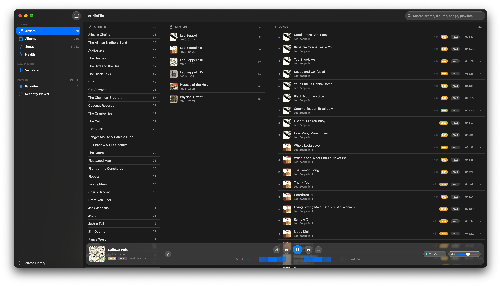
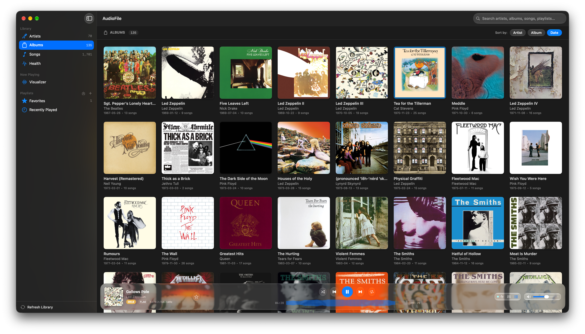
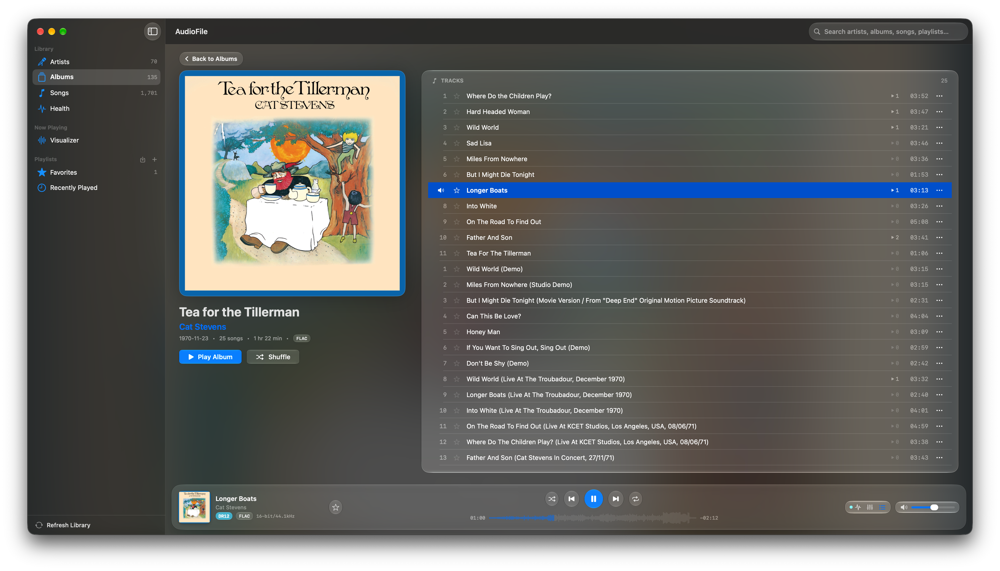
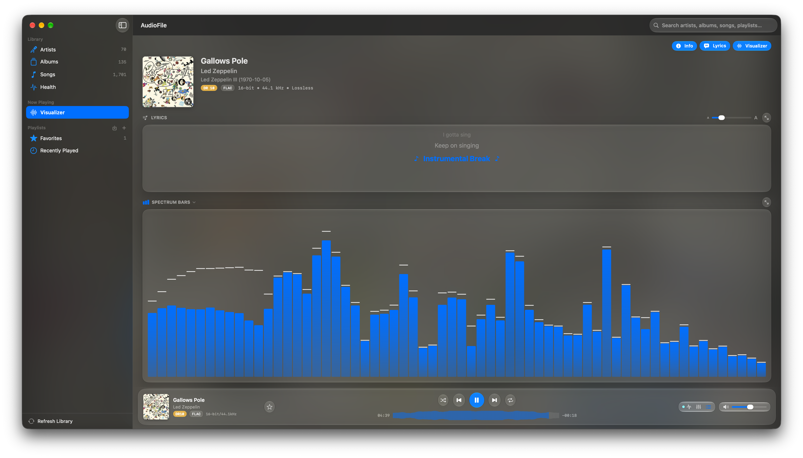
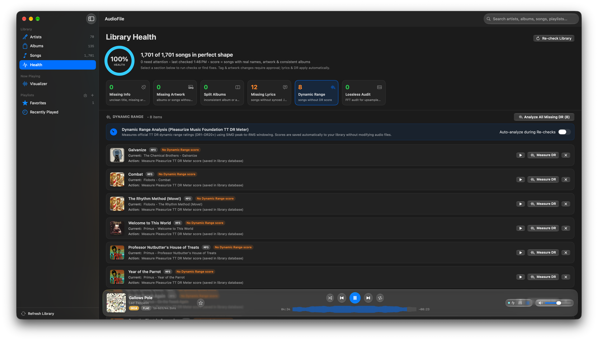
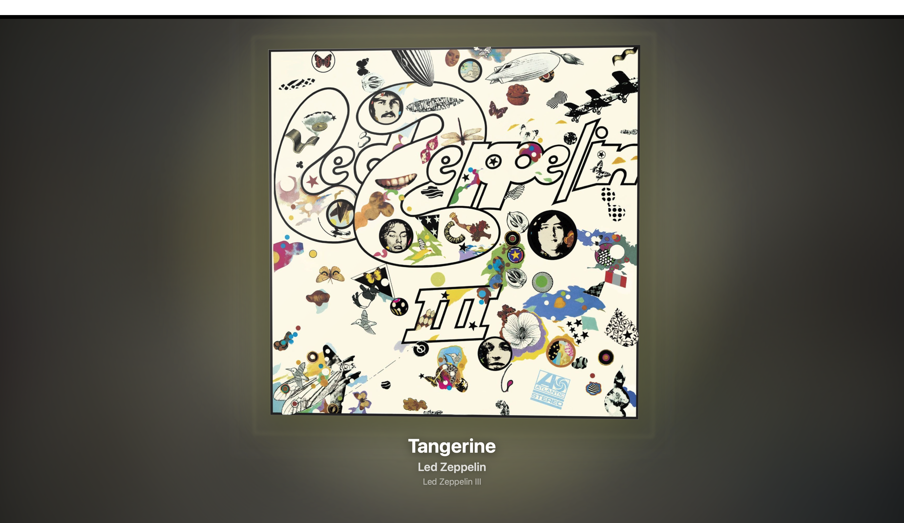
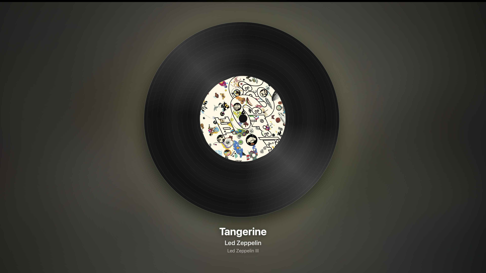
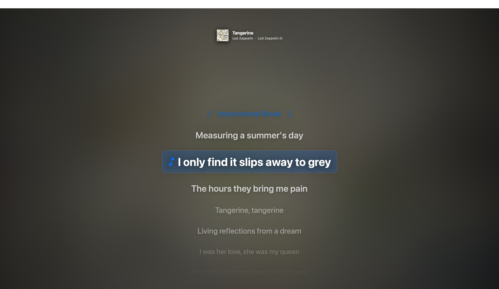
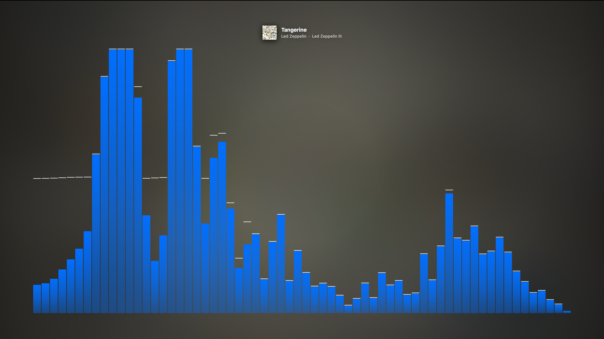

# ♬ AudioFile

> **Native macOS Audiophile Music Player**  
> Built with Swift 6, SwiftUI **Liquid Glass** (macOS 26+), CoreAudio, AVFoundation, and Accelerate (`vDSP`).

`AudioFile` delivers bit-perfect lossless playback, real-time `vDSP` spectrum visualization, synchronized lyrics, library health auditing, and CD playback/ripping inside a native **Liquid Glass** interface that dynamically adapts to your macOS system accent color.

<p align="center">
  
</p>

---

## ⬇️ Download & Install

### 1-Line Terminal Install (Recommended)
Downloads the latest pre-built `AudioFile.app` into `/Applications`, clears Gatekeeper quarantine, and launches immediately:

```bash
curl -fsSL https://raw.githubusercontent.com/jonecat/audiofile/main/scripts/install.sh | bash
```

### Direct Downloads
- **[Download `AudioFile.dmg`](https://github.com/jonecat/audiofile/releases/latest/download/AudioFile.dmg)** (macOS Disk Image Installer)
- **[Download `AudioFile.app.zip`](https://github.com/jonecat/audiofile/releases/latest/download/AudioFile.app.zip)** (Standalone App Bundle)
- **[All Releases on GitHub](https://github.com/jonecat/audiofile/releases/latest)**

*(If downloaded via a browser, run `xattr -cr /Applications/AudioFile.app` once after copying to `/Applications`. Future updates use the built-in self-updater automatically.)*

---

## 📸 Screenshots

### Albums Grid
Adaptive artwork grid with artist, album, and release-date sorting plus the floating Liquid Glass player deck:
<p align="center">
  
</p>

### Album Detail
Clean album header with release details, Play/Shuffle actions, and full multi-disc tracklist:
<p align="center">
  
</p>

### Now Playing — Synced Lyrics & 64-Band Visualizer
Real-time `vDSP` spectrum analyzer paired with 5-line synchronized lyrics and live text scaling:
<p align="center">
  
</p>

### Library Health
Automated audit dashboard with tag/artwork fixes, synced lyric fetching, TT Dynamic Range scoring, and FFT lossless verification:
<p align="center">
  
</p>

### Full-Screen Stage
Dedicated full-screen presentation with **Artwork** (*Audio Aura*, *Turntable*, *Pure*), **Synced Lyrics**, and **Spectrum Visualizer** modes:
<table>
  <tr>
    <td width="50%"></td>
    <td width="50%"></td>
  </tr>
  <tr>
    <td width="50%"></td>
    <td width="50%"></td>
  </tr>
</table>

---

## ✨ Features

- **Audiophile Playback & DSP**
  - Gapless lossless playback for **FLAC**, **ALAC**, **WAV**, **AIFF**, **DSD** (`.dsf`/`.dff` via multi-stage FFmpeg/FIR decimation), **APE**, **M4A/AAC**, and **MP3**, plus `.cue` sheet virtual tracks.
  - **CoreAudio DAC & Auto Sample-Rate Switching**: Output device selection and automatic hardware sample-rate matching (`44.1 kHz` – `384 kHz`).
  - **Signal Path Inspector**: Live chain breakdown from source file and sample rate through DSP stages to hardware output.
  - **10-Band Parametric EQ & DSP**: Bit-perfect bypass by default, built-in presets, **AutoEQ `.txt`** profile import, **ReplayGain** (Track/Album), and **BS2B Headphone Crossfeed**.
  - **Dynamic Range (DR) Meter**: On-demand Pleasurize Music Foundation (TT DR) scoring with persistent results and color-coded badges.
  - **Waveform Scrubber & Continuous Library Shuffle (`⇧⌘S`)**: Pre-computed 512-bin amplitude waveforms and non-stop full-library shuffle.
- **Liquid Glass Interface & Full-Screen Stage**
  - Native macOS 26+ **Liquid Glass** design adapting in real time to your system accent color.
  - **3-Column Artists Browser** (`⌘1`), sortable **Albums Grid** (`⌘2`) with **Album Detail**, sortable **Songs Table** (`⌘3`), global search (`⌘F`), and custom playlists with drag-and-drop reordering.
  - **Full-Screen Stage**: Dedicated borderless stage supporting **Artwork** (*Audio Aura*, *Turntable*, *Pure*), **Visualizer**, and **Synced Lyrics** (`⇧⌘F` / `⇧⌘V` / `⇧⌘L`).
- **Synced Lyrics & Visualizers**
  - **Synchronized Lyrics**: Multi-stage [LRCLIB](https://lrclib.net) fetching, local `.lrc` sidecar priority, offline disk cache, smooth instrumental break scrolling, and live text scaling.
  - **Real-Time `vDSP` Visualizers**: 2048-point FFT driving **Spectrum Bars** (64 bands), **Analog VU Meter**, and **Radial Halo** at **30 / 60 / 120 FPS**.
- **Library Health & Metadata**
  - 6-category library audit: **Missing Info**, **Missing Artwork**, **Split Albums**, **Missing Lyrics**, **Dynamic Range**, and FFT **Lossless Audit** (detects upsampled or lossy transcodes).
  - Batch fix approval, configurable file tag writing/renaming, and an integrated track metadata inspector/editor.
- **Audio CD Playback & Ripping**
  - Direct Audio CD playback with **MusicBrainz** metadata and **Cover Art Archive** artwork.
  - **AccurateRip**-verified ripping to **FLAC**, **ALAC**, **WAV**, **WavPack**, **Opus**, **Ogg Vorbis**, or **MP3**.
- **macOS Integration**
  - Incremental `stat`-cached background scanning (safe for offline NAS/external drives), media keys & Control Center (`MPNowPlayingInfoCenter`), drag-and-drop playback, and an automatic GitHub Releases self-updater.

---

## ⌨️ Keyboard Shortcuts

| Action | Shortcut |
| :--- | :--- |
| **Play / Pause** | `Space` or media key |
| **Previous / Next Track** | `←` / `→` or `⌘←` / `⌘→` |
| **Seek ±5s / ±30s** | `⇧←` / `⇧→` or `⌥⌘←` / `⌥⌘→` |
| **Volume Up / Down / Mute** | `+` / `-` / `M` |
| **Queue Shuffle / Shuffle Library / Repeat** | `Z` / `⇧⌘S` / `R` |
| **Favorite Track(s)** | `F` |
| **Artists / Albums / Songs / Health** | `⌘1` / `⌘2` / `⌘3` / `⌘4` |
| **Visualizer / Favorites / Recently Played** | `⌘5` / `⌘6` / `⌘7` |
| **Audio CD / Eject Disc** | `⌘D` / `⌘E` |
| **Global Search / Settings** | `⌘F` / `⌘,` |
| **Toggle Info / Lyrics / Visualizer** | `I` / `L` / `V` |
| **Full-Screen Artwork / Visualizer / Lyrics** | `⇧⌘F` / `⇧⌘V` / `⇧⌘L` |
| **Cycle Full-Screen Effect / Exit Full-Screen** | `E` / `Esc` |

---

## 🛠️ Building from Source

**Requirements:** macOS 26.0+ and Xcode / Command Line Tools (Swift 6.2+).

```bash
git clone https://github.com/jonecat/audiofile.git
cd audiofile

# Run in debug mode
swift run AudioFile

# Build signed AudioFile.app, AudioFile.app.zip, and AudioFile.dmg
./scripts/build_app.sh
```

**Data & Cache Locations:**
- **App Data & Config:** `~/Library/Application Support/AudioFile/` (`config.json`, `library.json`, `playlists.json`, `dynamic_range_db.json`, `ignored_health_issues.json`)
- **Caches:** `~/Library/Caches/AudioFile/` (`waveforms/`, `lyrics/`, `decoded/`)

---

## 👤 Author & License

Created by **Jon Lawrence** — [github.com/jonecat/audiofile](https://github.com/jonecat/audiofile)  
Released under the **MIT License**.
